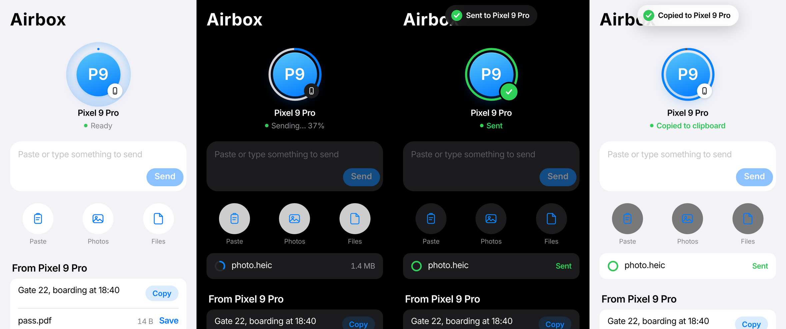
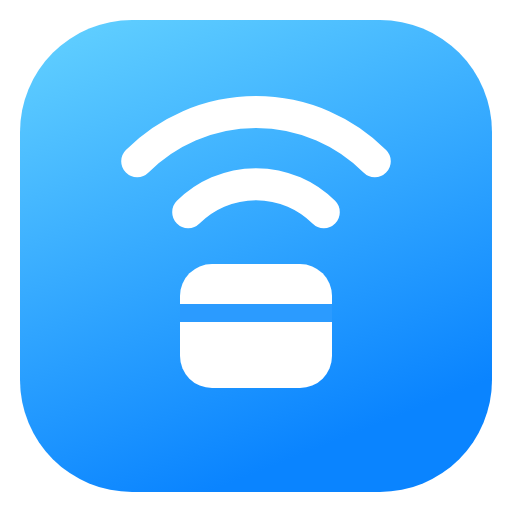

# Airbox design system

One look on iPhone, Android and the no-app Safari page: Apple's, close to AirDrop.

## The one bold moment

The other phone appears as an **avatar bubble with soft ripples** behind it. When you send:

1. The ripples stop and a **ring fills round the avatar** (blue, from 12 o'clock, clockwise).
2. At 100% it turns **green**, the avatar gives a small spring “pop”, a **✓ badge**
   springs in at the bottom-right, the phone gives a light haptic, and the status line
   reads **Sent**.
3. A banner slides down from the top: “Sent to Pixel 9 Pro”.
4. After about 2.5 s it settles back to “Ready”.

Everything else is deliberately quiet, so the ring is what you notice. On iPhone the
same moment also plays around the Dynamic Island ([DYNAMIC_ISLAND.md](DYNAMIC_ISLAND.md)).

## Tokens

| | Light | Dark |
|---|---|---|
| Background | #F2F2F7 | #000000 |
| Surface (cards, action circles) | #FFFFFF | #1C1C1E |
| Pressed / track | #E9E9EF | #2C2C2E |
| Label / secondary | #000000 / 60% #3C3C43 | #FFFFFF / 60% #EBEBF5 |
| Blue (progress, actions) | #007AFF | #0A84FF |
| Green (done) | #34C759 | #30D158 |
| Red (failed) | #FF3B30 | #FF453A |
| Ripple, app icon | #0A84FF → #64D2FF | same |

**Type:** SF Pro on Apple devices; Inter (bundled) on Android, which is the closest open
match. iOS scale: Large Title 34/41 bold, Title 3 20 semibold, Headline 17 semibold,
Body 17, Subhead 15, Footnote 13, Caption 12. Numbers that change (percentages) use
rounded, fixed-width digits so they don't jitter.

**Shapes:** circles for people and actions (90 pt avatar, 62 pt action buttons, like the
iOS share sheet). 22 pt corners for the compose field, 14 pt for grouped lists.

**Motion:** springs for things that confirm (✓, pop, banner); 0.3 s ease for progress;
ripples only while waiting. Reduce Motion turns off the ripples and transitions.

## Where it lives

| Surface | Files |
|---|---|
| Safari page (no app) | `core/src/main/resources/airbox-web/` |
| iPhone app | `ios/Airbox/PeerRadar.swift`, `ContentView.swift`, `IslandHalo.swift` |
| Android app | `android/app/src/main/java/app/airbox/android/ui/` (`Components.kt` has `PeerBubble`) |
| App icon | `design/icon/` (full set, made with the icon-creator tool; iOS 1024 and Android adaptive icon included) |

