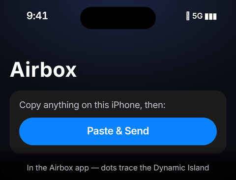

# Dynamic Island and "paste in the app"

## First, a trade-off

The Dynamic Island only shows Live Activities from **an app installed on the iPhone**.
So Airbox now has two iPhone modes. People pick one, or use both:

| | No-app mode (Safari / Shortcuts / AirDrop) | Airbox iPhone app |
|---|---|---|
| Install on iPhone | nothing | Airbox (App Store) |
| Copy on iPhone → paste on Android | open page → Paste → Send, or Back Tap | **one tap: "Paste" button, no permission pop-up** |
| Dynamic Island | ❌ | ✅ |
| Photos / files | ✅ | ✅ |

## Copy on iPhone, paste on Android (app)

1. Copy anything on the iPhone.
2. Open Airbox and tap the system **Paste** button. Apple's own Paste button doesn't show
   the "Allow Paste?" alert that apps get when they read the clipboard themselves.
3. The text lands on the Android clipboard. The Dynamic Island shows **"Copied to Pixel ✓"**
   for 4 seconds.

What Apple doesn't allow: sending automatically the moment you copy, or sending from the
Dynamic Island without opening the app. Apps can't read the clipboard in the background.

## What goes on the Dynamic Island

Apple's rules: Live Activities are for things with a start and an end. They last at most
8 hours, and the island shows at most two at once. So Airbox shows only the important,
time-bound things, ranked like this:

| Priority | What | Compact island | Expanded island buttons |
|---|---|---|---|
| 1 | **Incoming call on the Android phone** | 📞 caller name | Decline |
| 2 | **Android phone ringing** (find my phone) | 🔔 | Stop |
| 3 | **Files moving** either way | ↕ progress ring / 42% | Cancel |
| 4 | **Clipboard**: "Copied to Pixel ✓", or "Text from Pixel" | ✓ / Text | Copy |
| 5 | **Music playing on Android** | ♪ ▶ | ⏮ ⏯ ⏭ |

- **Android battery** never gets its own island. It appears inside whichever item is
  showing (e.g. "🔋 64%"), because a permanent status bubble breaks Apple's guidelines
  and would get the app rejected.
- **Android notifications** (WhatsApp, SMS…) appear as normal iPhone notifications, not
  on the island. Apple reserves the island for ongoing activities.
- Progress updates are throttled (at most 1 per second unless the progress jumps 5%) to
  save battery. Text is trimmed so each update stays under ActivityKit's ~4 KB limit.

These rules live in one place: `core/.../live/LiveStatus.kt` (`IslandModel`, 9 tests). The
iPhone app mirrors them in `ios/Airbox/IslandController.swift`.

## Look and motion

(A design preview rendered from `docs/design/island-preview.html`, using the same geometry
and timing as the Swift code. Open the HTML in a browser to watch it live. The preview uses
Inter because SF Pro isn't available outside Apple devices; the app itself uses SF Pro.)

**While Airbox is open** (`ios/Airbox/IslandHalo.swift`):
1. A ring of dots fades in 7 pt outside the island, following its capsule shape.
2. Dots light up clockwise from the bottom centre as the file sends. A pill underneath
   counts up in SF Pro Rounded, with digits that roll as they change.
3. At 100% the dots fuse into one glowing green line with a small spring pulse. The pill
   becomes "✓ Sent to Pixel": the tick draws itself in, with a success haptic.
4. After 1.6 s it all shrinks back into the island and fades.
5. On failure the ring turns red with an error haptic.
6. With Reduce Motion on, progress updates appear without the motion.

**After you leave the app** (the Live Activity): the island's right side shows a 12-dot ring
that lights up as progress comes in, then turns into a green ✓. The expanded island shows a
large dot ring with the percentage in the middle.

Two limits from Apple, not choices:
- **Nothing can be drawn outside the island from a Live Activity.** The system clips it. The
  dots-around-the-island effect is only possible while the Airbox app is on screen, which
  is when you tap Paste & Send anyway.
- **Live Activities don't animate frame by frame.** They change when the app sends an
  update, with a short built-in transition. The dot ring therefore steps up rather than
  sweeping smoothly.

Island position comes from measured sizes (126 × 37.33 pt; 11.33 pt from the top, 14 pt on
16 Pro models), because Apple doesn't publish the island's frame. Check it on each new
iPhone model. Phones without an island get the same animation around a virtual pill under
the status bar.

**Typography:** the iPhone system font everywhere: SF Pro Text and SF Pro Display, with SF Pro
Rounded and fixed-width digits for numbers. The Safari page uses the same font and follows
the iPhone's text-size setting.

## The big limitation: when the iPhone app is in the background

Right now the iPhone app hears from Android over **Wi-Fi** (a long-poll on
`/api/events`). iOS suspends apps about 30 seconds after you leave them. After that:

- ✅ Things the **iPhone** started keep their island (e.g. a finished upload, "Copied ✓").
- ❌ New events **from Android** (a call, ringing, a new transfer) don't reach the island
  until you open Airbox again.

Two ways to fix it. Neither is built yet:

1. **A Bluetooth LE link (recommended, no internet).** iOS lets an app with the
   `bluetooth-central` background mode be woken when its paired accessory sends data. The
   Android phone would advertise as that accessory. This is the `CompanionLink` design in
   [COMPANION.md](COMPANION.md). Risk: real-phone stability and battery use are unmeasured.
2. **Apple push for Live Activities.** Android → a small Airbox server → Apple's push
   service updates the island. It always works, but needs internet, a server, and an
   Apple developer push key. It contradicts "nothing through the cloud", so it would be
   opt-in only.

Until one of these exists, describe it honestly: **"Live on the Dynamic Island while
Airbox is open or recently used."**

## Android's version of the Dynamic Island

Android 16 has **Live Updates**: an ongoing notification built with `ProgressStyle` that
Android promotes to a chip in the status bar. Samsung's One UI shows similar items in the
Now Bar. The Android app should drive it from the same `IslandModel`:

- `TRANSFER` → `Notification.ProgressStyle` with the progress, a Cancel action, and a
  short chip text ("42%").
- `INCOMING_CALL` (an iPhone call, seen through ANCS) → a promoted ongoing notification
  with Decline.
- It needs the `POST_PROMOTED_NOTIFICATIONS` permission. Check
  `NotificationManager.canPostPromotedNotifications()`. On Android 15 and older it falls
  back to a normal ongoing notification.

Unverified: Google has changed the promotion rules during Android 16 betas. Re-check the
current requirements before building.

## Code

| Path | What |
|---|---|
| `core/.../live/LiveStatus.kt` | Shared island rules: priorities, throttle, expiry, 8-hour cap, size cap |
| `core/.../web/WebBridge.kt` | `/api/app-pair` (scan once → revocable key), `/api/events` long-poll feed, `/api/action` (island buttons → Android), `publishIsland` / `endIsland` |
| `ios/` | SwiftUI app: pairing by QR scan, Paste & Send, photos, live feed, Live Activity + Dynamic Island widget, buttons via `LiveActivityIntent` |

**Not compiled.** No Swift toolchain was available in the environment where this was
written. All Swift files pass a syntax parse, and a manual review fixed three compile
errors, but expect a few more when you first build in Xcode.
