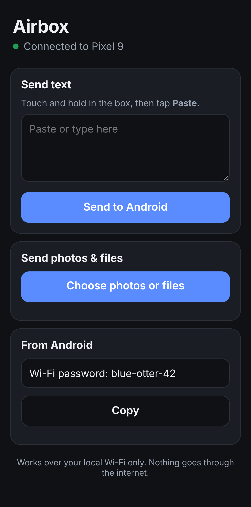

# iPhone with no app installed

Requirement: nothing gets installed on the iPhone. The Android phone uses Airbox or Quick
Share. Example task: copy text on the iPhone, paste it on Android.

## The short answer

| Way | Install on iPhone | Install on Android | Works with | Status |
|---|---|---|---|---|
| **A. AirDrop → Quick Share** | nothing | nothing | Pixel 10 now. Google says Samsung, OPPO and others are coming during 2026 | Built by Google. Airbox isn't involved. |
| **B. Safari page served by Airbox** | nothing (Safari + Camera) | Airbox | any Android phone, same Wi-Fi or Android hotspot | **Built in this repo** (`core/.../web/`) |
| **C. iOS Shortcuts + Back Tap** | nothing (Shortcuts comes with iOS) | Airbox | same as B | Server side built. The user creates the shortcut once. |
| ~~D. Airbox receiving real AirDrop~~ | – | – | – | **Not possible.** AirDrop runs over AWDL, an Apple-only Wi-Fi link. Android apps can't speak it without root and kernel changes. Google could only do it in the OS itself. |

## A. AirDrop → Quick Share (best, when the Android phone supports it)

1. On Android, open Quick Share and set visibility to **Everyone for 10 minutes**, or open
   receive mode.
2. On the iPhone, select the text, then **Share → AirDrop →** pick the Android phone.
3. Accept on Android.

Limits: it only works in AirDrop's "Everyone for 10 minutes" mode, not "Contacts Only". It's
limited to phones Google has enabled. **Unverified:** whether plain text snippets (as opposed
to files, photos and links) arrive as text, or arrive at all. Test on a Pixel 10 before
promising it.

## B. Safari page (any Android phone)

1. On Android, open Airbox and tap **Connect iPhone**. A QR code appears.
2. Point the iPhone **Camera** at it, then tap the link. Safari opens the Airbox page, served
   by the Android phone over Wi-Fi.
3. **iPhone → Android text:** touch and hold in the box → Paste → **Send to Android**. Airbox
   puts the text on the Android clipboard and shows a notification. Then paste anywhere on
   Android.
4. **iPhone → Android photos/files:** Choose photos or files. Originals are sent, with a
   progress bar.
5. **Android → iPhone:** share text or files to Airbox on Android, then choose
   "iPhone (browser)". They appear on the page with **Copy** / **Save**.

The page stays signed in for 12 hours. After that, scan again.

No Wi-Fi in common? Airbox can start an Android **hotspot** and show a Wi-Fi QR code first.
The iPhone camera joins it, then scan the page QR code (`WifiQr` builds the code).

## C. One-tap clipboard with Shortcuts and Back Tap

Once set up: copy on the iPhone, double-tap the back of the iPhone, then paste on Android.

1. In Airbox on Android, go to **Settings → iPhone Shortcut → Create key**. It shows a URL
   and a key.
2. On the iPhone, open **Shortcuts → +** and add:
   - **Get Clipboard**
   - **Get Contents of URL**: URL `http://<android-address>:<port>/api/text`, Method
     **POST**, Header `Authorization` = `Bearer <key>`, Request Body **File** = *Clipboard*
3. Name it "Send clipboard to Android".
4. **Settings → Accessibility → Touch → Back Tap → Double Tap →** choose that shortcut.

Limit: the shortcut stores the Android phone's address. If the Wi-Fi gives the phone a new
address, the shortcut needs editing. A reserved address on the home router avoids this.

## What's still missing compared with Apple's Universal Clipboard

- **Not automatic.** iOS doesn't let anything read the iPhone clipboard in the background,
  so there's always one action: Send, Back Tap, or AirDrop.
- **Android → iPhone** text needs the page open (Copy) or AirDrop from a Quick Share phone.
- **Same network required** (or the Android hotspot). There's no internet relay by design.

## Security, plainly

Safari won't trust a certificate made by a phone without a full-page warning, so the page
uses **plain HTTP on the local network**. What protects it:

- A single-use, 10-minute QR token, exchanged for an HttpOnly, SameSite=Strict cookie. The
  token is removed from the address bar right away.
- POSTs require a custom header, which blocks other websites from sending to the phone
  (CSRF). Public hostnames are refused, which blocks DNS rebinding.
- Lockout after 10 bad attempts. Revocable Shortcut keys. No caching, a strict content
  security policy, and file names cleaned before saving.

What doesn't: someone **on the same Wi-Fi** who can capture traffic could read what's sent.
Use it at home or over the Android hotspot (WPA2, private to the two phones), not on café or
hotel Wi-Fi. Hotel networks often block device-to-device traffic anyway.
