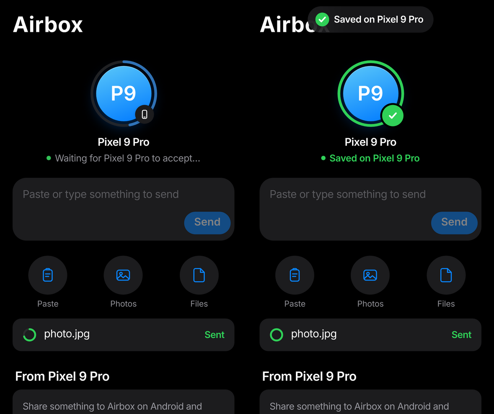

# Pair once, then it just works

What you asked for: two personal phones that know each other, no QR code every time,
share from the iPhone Share sheet, an Accept / Decline prompt on the Android phone, photos
saved straight into the Photos / Gallery app, and copy on the iPhone → paste on Android.

## First: your OnePlus may already do this natively

On the **OnePlus 15**, Google's Quick Share update (rolling out since June 2026) makes the
phone appear in the iPhone's own **AirDrop** list:

1. On the OnePlus, set Quick Share visibility to **Everyone**.
2. On the iPhone, open AirDrop and set **Everyone for 10 minutes**, then Share → AirDrop →
   tap the OnePlus.
3. Accept on the OnePlus. Photos are saved to the Gallery.

This works across different Wi-Fi networks, as long as the phones are close. The limits
are that AirDrop's 10-minute "Everyone" mode has to be switched on each time, and there's
no clipboard sharing. Other OnePlus models don't have it yet. Airbox (below) works on
any Android phone.

## Airbox: what changed

| You wanted | What happens now |
|---|---|
| Don't scan every time | Scan **once**. The iPhone is remembered for a year (or until you tap *Forget* on Android). Reopen the Airbox page any time, no QR code. |
| Share → pick the OnePlus | Share sheet → **Send to OnePlus** (a Shortcut set up once from the Airbox page; no app to install). |
| Accept or decline on the OnePlus | A pop-up at the top of the screen, **Accept / Decline / Always accept**, like AirDrop. One prompt per share, however many photos. Nothing is saved before you accept. |
| Saved in Photos | Photos go to **Pictures/Airbox** and videos to **Movies/Airbox**, so they appear in Google Photos / Gallery right away. Other files go to Downloads/Airbox. |
| Copy on iPhone, paste on Android | Double-tap the back of the iPhone (Back Tap shortcut). Text **and images** land on the Android clipboard, so the keyboard can paste them anywhere. Copied images are also saved to the Gallery. |
| Trust my own phone completely | Turn on **Always accept** for it (prompt or *My devices*): no more prompts from that iPhone. |

## Different Wi-Fi, phones close

Without an app on the iPhone, the two phones need *a* network in common. Two ways that
need no internet:

- **Use the OnePlus hotspot.** Turn on the hotspot on the OnePlus and join it on the
  iPhone once. The iPhone remembers it, so it's one tap next time. This is the most
  reliable way when you're out.
- **Same Wi-Fi at home.** Give the OnePlus a fixed address in your router (DHCP
  reservation), so the Shortcut never needs editing.

Fully automatic "close together on any Wi-Fi" (Bluetooth finds the phone, then a direct
Wi-Fi link) needs the **Airbox iPhone app**, because iOS only lets apps use Bluetooth and
Wi-Fi Aware. That app exists in `ios/`, but installing it needs an Apple developer
account: free (re-signed every 7 days) or $99/year (TestFlight).

## Honest limits

- **The share-sheet entry is a Shortcut,** labelled "Send to OnePlus". It is not inside
  the AirDrop row. Only Apple and Google can put a phone in that row (see the OnePlus 15
  section above).
- **Copy-paste needs one gesture (Back Tap).** iOS doesn't let anything send the clipboard
  in the background.
- **The Android pop-up is a high-priority notification.** Android blocks apps from opening
  full screens while in the background. If notifications for Airbox are silenced, the
  prompt waits in the app.
- **iPhone Home Screen bookmarks keep their own cookies.** If you add the Airbox page to
  the Home Screen, scan once more from there. A Safari bookmark shares Safari's pairing.
